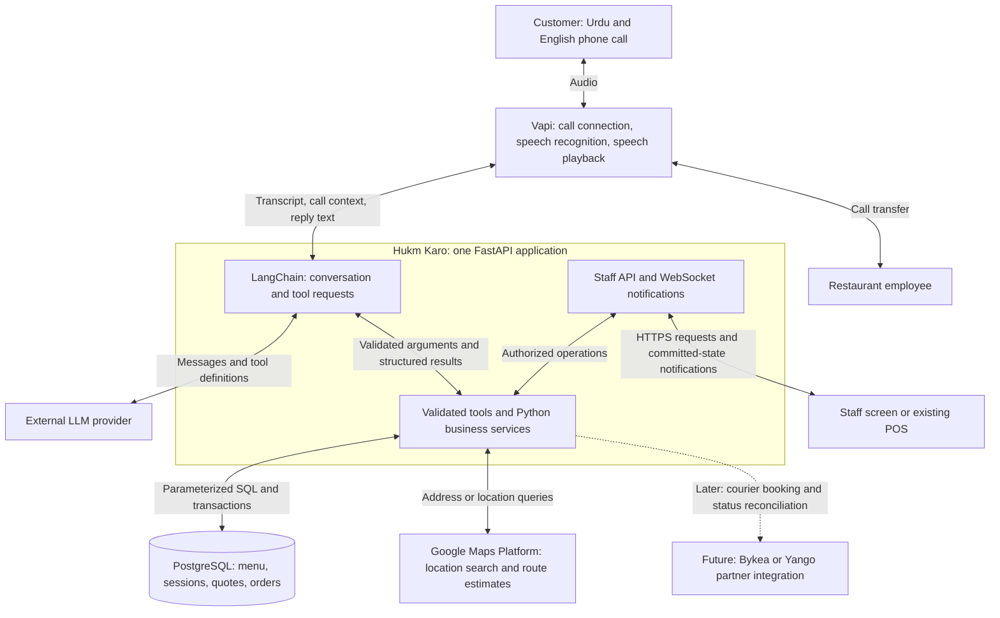
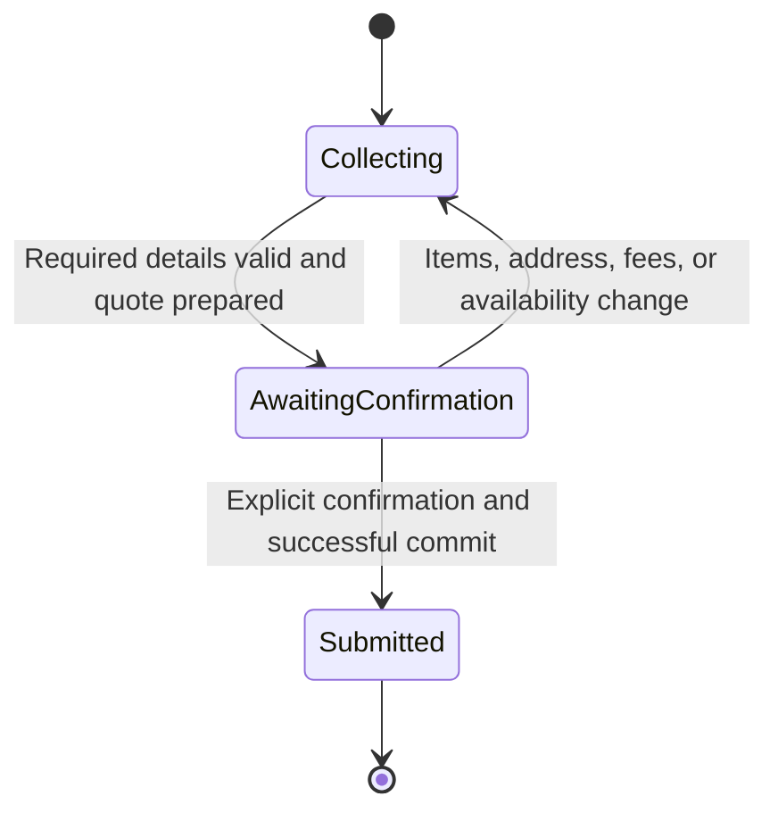

**Hukm Karo: learn system design by following one restaurant order**

This is a proposed design and learning guide. It describes the target MVP and a later courier extension; it does not claim these integrations already work. The application remains one FastAPI backend with modules, PostgreSQL, and a staff interface. Each box below represents a responsibility, not a separate server.

The MVP includes Google-assisted address resolution. Bykea or Yango delivery booking belongs to the later version. Provider access, Pakistani telephone routing, and real-call performance still need verification.

**1. Read the architecture from the caller to the kitchen.**

Vapi's connection to LangChain is a proposed integration. In the current repository, the Vapi webhook dispatches tools directly, while the LangChain orchestrator is separate. Connecting these paths is an implementation task.

**2. Understand what each component is allowed to decide.**

| Component | Responsibility | Concrete example |
| --- | --- | --- |
| Voice layer | Recognize speech, play replies, handle interruptions | Stop speaking when the customer interrupts |
| LLM through LangChain | Interpret language and request a permitted action | Interpret “isay do kar do” as changing the discussed item to quantity two |
| Pydantic | Validate the structure and basic constraints of inputs | Reject negative quantities |
| Python services | Enforce restaurant rules and calculate results | Check allowed toppings and calculate the item price |
| PostgreSQL | Store authoritative business data and committed changes | Preserve an order after an application restart |
| Google Maps Platform | Return location candidates and route information | Find a named landmark and estimate a route |
| Staff interface | Display orders and submit authorized staff actions | Mark an order as preparing |
| Future courier integration | Request delivery and reconcile the provider's reported progress | Record that a rider has been assigned |

This is **separation of concerns**: each component has a clear job. Changing the speech provider should not require changing pizza pricing.

LangChain is a library inside your backend. Your Python service calls are ordinary function calls unless there is a specific reason to cross a network. A modular monolith is an application organized into modules and deployed together; that matches the project's current needs.

**3. Follow one order through the system.**

Suppose a customer says: “Bhai do zinger, aik without mayo, aur large fries. Gulshan Block 4 delivery.”

1. The call reaches Vapi. Speech recognition produces text. This text may contain mistakes, so consequential ambiguities require clarification.
2. Your backend associates the verified call with the correct restaurant and branch context. The LLM does not establish that identity.
3. LangChain sends the conversation, current cart, and permitted tool definitions to the LLM.
4. The model requests a menu search. The backend returns real items and available choices. The model uses the returned identifiers rather than inventing them.
5. Python validates the requested items and customizations. The two burgers need distinguishable lines because their instructions differ.
6. The cart is saved. If the customer says “fries regular kar do,” the existing fries line changes and the total is recalculated.
7. The address tool resolves the area or landmark through Google. The agent collects the remaining house, building, floor, and landmark details and asks the customer to confirm.
8. Python checks delivery coverage and computes a quote using restaurant rules and database prices.
9. The agent reads the relevant items, customizations, address, charges, and total. It asks whether the customer wants to place this order.
10. After explicit confirmation of the current quote, Python commits the order once. It returns the saved order reference.
11. Staff can retrieve the order. A notification tells the staff screen to refresh; the saved order remains retrievable if the notification is missed.
12. The agent distinguishes “your order was received” from “the kitchen accepted it” using the actual recorded state. Preparation and delivery promises require restaurant-backed estimates.

**4. Learn API contracts and trust boundaries.**

An API contract defines what a caller may send and what it can expect back. A tool contract does the same for the model.

An illustrative tool request is `add_to_cart(menu_item_id=101, quantity=2)`. The call/session identity comes from trusted backend context. A supplied item ID is still checked against that restaurant's menu.

Validation happens in layers:

| Check | Example |
| --- | --- |
| Shape and type | Quantity is an integer, and required fields exist |
| Business rule | The topping belongs to this pizza size and is available |
| Authorization | This staff member may update this branch's orders |
| Database constraint | An order item references an existing order and has positive quantity |

Pydantic can check input shape, but it cannot establish that an item belongs to a restaurant without application/database checks. Authentication establishes who is making the request; authorization establishes what they may do.

Tool results should consistently distinguish success, missing information, business rejection, and temporary failure. Money should have an explicit JSON representation, such as decimal strings with a currency code. Python `Decimal` and timestamp objects need serialization before being placed in a JSON tool message.

Read first: [tool schemas](backend/schemas/tools.py), [cart tools](backend/tools/cart_tools.py), and [API routes](backend/api/routes.py).

**5. Learn state, persistence, and state machines.**

State is what the system currently knows. Conversation history explains what was discussed; the cart records what will be ordered. Keep both consistent, but use the saved cart to establish the order contents.

Useful session facts include the cart, its revision, the current unanswered question, the item under discussion, fulfillment mode, address confirmation, quote, and submitted order reference. This is a proposed extension to the current session model.

An in-memory dictionary is local to one running process. PostgreSQL persistence allows another request or a restarted process to recover saved state. Persist each successful mutation before claiming that it is saved. Do not silently continue a checkout after its required persistence fails.

A **state machine** defines allowed transitions and their conditions. The following governs checkout; it does not force callers to provide details in a rigid order.

“Theek hai” in response to a drink choice must not submit the order. The system must know which question is being answered. Confirmation must refer to the current cart and quote, and the model must not be able to bypass the gate by supplying its own `confirmed=true` flag.

Read first: [cart schema](backend/schemas/cart.py), [session manager](backend/agent/session_state.py), and [orchestrator](backend/agent/orchestrator.py).

**6. Learn deterministic business logic and money handling.**

Deterministic means the same validated input and authoritative data produce the same result. Your model can interpret “large with extra cheese”; Python applies the pricing rules.

For illustration only, suppose a large pizza costs Rs. 1,500, an eligible cheese topping costs Rs. 200, and delivery costs Rs. 150:

`food = 1,500 + 200 = 1,700; total = 1,700 + 150 = 1,850`

A size may replace a base price; a topping may add to it. Those semantics must be explicit in the menu rules. The current code replaces the item price with each positive choice price, so it needs correction before supporting paid add-ons reliably.

Use decimal arithmetic for money and define rounding rules. Revalidate the quote before committing. If a price or fee changed, generate a new quote and ask for confirmation again.

Read first: [cart service](backend/services/cart_service.py) and [pricing tests](backend/tests/test_pricing.py).

**7. Learn relational modeling and transactions.**

A relational database stores related facts in tables. A restaurant has branches; an order has order items; an item can have selected options. Foreign keys connect these records.

An order item should preserve the name, charged price, and selected options at purchase time. Looking up today's menu price cannot reconstruct what a customer paid yesterday. Your current schema already includes several of these snapshot fields.

A **transaction** groups writes that must succeed together. Checkout should atomically record the order, its items/options, and the submission identity that prevents duplicate orders. If a required insert fails, the transaction rolls back.

Atomicity means all those writes succeed together or none become committed. Durability means a successful commit survives an application restart. Neither property makes a later network response or kitchen notification automatically reliable.

Keep Google/LLM requests outside database transactions. Holding a database lock while waiting for an external API slows other requests and increases contention.

Read first: [database schema](backend/db/schema.sql), [connection management](backend/db/connection.py), and [order service](backend/services/order_service.py).

**8. Learn idempotency and concurrency through two bugs.**

**Bug A: the database saves an order, but the response is lost.** The caller retries and creates a second order.

An **idempotency key** identifies the original operation. Store and enforce it in PostgreSQL so a retry returns the original outcome. A database uniqueness rule must also protect against simultaneous retries; checking in Python and inserting later leaves a race.

Repeated delivery of the same `add_to_cart` operation should change the cart once. A new customer request to “add one more” is a new operation and should increase quantity again. Deduplicating by identical text would confuse these cases.

**Bug B: two requests read cart revision 7 and both save different changes.** The later save erases the earlier change.

This is a **race condition**. Use a short database transaction with a suitable lock, or a revision check that rejects a write based on stale state. Choose the simplest strategy that works across application processes. A Python lock protects only the process that owns it.

The same rule applies to slow address lookups: if the customer changes the address while Google is responding, the old result must not overwrite the new address.

**9. Learn external APIs through the smart address tool.**

The proposed `resolve_delivery_address` tool performs application-controlled steps:

1. Read the customer's address and confirmed city context. Keep private unit and delivery instructions separate from the location-search query when unnecessary for lookup.
2. Use Geocoding for address-to-location lookup, or Places Text Search for a named place or landmark. These return possible locations, not proof of a deliverable apartment. [Geocoding documentation](https://developers.google.com/maps/documentation/geocoding/geocoding), [Places Text Search documentation](https://developers.google.com/maps/documentation/places/web-service/text-search).
3. If several locations fit, ask a short clarification. If only an area or landmark is found, collect the remaining destination details instead of treating the landmark as the customer's doorstep.
4. Ask the customer to confirm the interpreted address. A normal phone call does not automatically provide their GPS location.
5. If the restaurant's delivery rules need road distance, request a route for the selected branch and destination. For the single-branch MVP, Compute Routes handles that pair. A route matrix becomes useful when comparing branches. Route duration is an estimate; food preparation and rider waiting time must be accounted for separately. [Compute Routes documentation](https://developers.google.com/maps/documentation/routes/compute_route_directions).
6. Python applies the restaurant's coverage, minimum-order, and fee rules. Google does not determine the restaurant's commercial policy.

Correction to the earlier discussion: Pakistan is not listed in Google's current Address Validation API coverage. Do not make that separate product an MVP dependency. Google-assisted lookup plus customer confirmation is the planned approach. [Address Validation coverage](https://developers.google.com/maps/documentation/address-validation/coverage).

Missing, ambiguous, or failed lookup results must remain explicit. Do not fabricate coordinates or assume a failed delivery check means the address is serviceable. Offer clarification or staff handling.

Real integration requires enabled APIs, billing/configuration, and a restricted server credential, conventionally `GOOGLE_MAPS_API_KEY`. No key is needed to understand this design. Provider data storage and display rules must be checked when implementing the integration; avoid designing an unrestricted permanent cache of Google responses.

**10. Learn HTTP, WebSockets, and eventual consistency through the kitchen screen.**

HTTP is suitable for fetching current orders and submitting staff actions. A WebSocket is a persistent connection that lets the backend notify the staff screen when something changes.

Save an order first, then notify. On initial load, reconnection, and periodic reconciliation, the screen retrieves authoritative current orders through the API. This also catches a notification lost because the backend stopped immediately after committing.

The database may show a new order briefly before the screen refreshes. This is **eventual consistency**: the screen catches up with saved state. A notification is a prompt to update the view; it is not the only record of the order.

The staff screen submits a requested status change. The backend checks staff authorization and the allowed transition. Your current order enum defines statuses, but having an enum alone does not enforce which transitions are allowed.

**11. Learn distributed systems through the future courier integration.**

Bykea or Yango integration is a future capability. The actual partner APIs, credentials, coverage, pricing, cash collection, cancellation rules, and status-delivery mechanism are **UNKNOWN until official documentation and commercial access are verified**. The operations below describe requirements, not known provider endpoints.

The intended flow is: restaurant accepts order, dispatch timing is chosen, backend requests a courier, provider reports progress, backend updates the delivery record, staff/customer see that progress. If the quoted courier fee affects what the customer pays, obtain or define that charge before checkout and define who absorbs later differences.

Track restaurant order state, courier delivery state, and payment state separately. “Food ready” does not imply “rider arrived,” and “delivered” does not by itself prove that cash was settled.

Here you meet **partial failure**: PostgreSQL may be working while the courier API is unavailable. A timeout after booking means the result can be unknown; it does not prove that booking failed. Reconcile using documented provider identifiers or lookup facilities before risking another booking. If safe automated reconciliation is unavailable, route the issue to staff.

Provider webhooks, if available, must be authenticated according to the actual provider contract. They may be repeated or arrive out of order. Deduplicate events and prevent an old event from overwriting newer state. Use polling if that is the supported contract.

A local PostgreSQL transaction cannot roll back a courier's external booking. Cancellation is a separate operation with its own outcome. This is why external delivery requires more failure handling than inserting an order row.

**12. Learn latency, observability, and testing.**

For a voice turn, perceived delay includes speech endpoint detection, transcription, network time, model response, any tool round trips, and speech generation. Some stages can overlap through streaming. Measure them separately before optimizing.

One slow database query and three unnecessary model/tool cycles require different fixes. A filler phrase can acknowledge waiting; it does not remove the delay. Interrupting speech should stop stale audio and invalidate stale uncommitted work, while already committed actions must be checked and explained accurately.

**Observability** means having enough evidence to explain what happened. Correlate events with a call ID, operation ID, cart revision, and order ID. Record timings and safe error codes; avoid secrets and unnecessary personal data in logs.

| Test type | What it proves here |
| --- | --- |
| Unit test | A size and two add-ons produce the expected total |
| Database integration test | Partial order creation rolls back; concurrent duplicate submissions create one order |
| API/contract test | Realistic provider payloads and database value types are accepted and serialized correctly |
| Conversation evaluation | Corrections and ambiguous confirmations lead to the expected state |
| End-to-end phone test | Spoken request becomes the correct staff-visible ticket over the real call route |

Mocks help isolate code, but they do not prove that credentials, provider APIs, or telephone routing work. A passing model-routing keyword test does not establish Urdu order-taking accuracy.

**13. Use the four-day MVP as your learning sequence.**

| Day | Engineering milestone | CS concepts to study | Your learning exercise |
| --- | --- | --- | --- |
| 1 | Correct menu, cart, checkout, and provider readiness; begin Google lookup verification | Validation, relational data, decimal arithmetic, transactions | Calculate a customized order by hand, then compare every stored field |
| 2 | Connected LangChain/voice flow, persistent corrections, Google address clarification, confirmation gate | State machines, API contracts, idempotency, concurrency | Explain why a repeated webhook differs from “add one more” |
| 3 | Staff screen, delivery rules, recovery, and staff transfer | HTTP, WebSockets, authentication, authorization, eventual consistency | Disconnect the staff screen, place an order, reconnect, and explain recovery |
| 4 | Integrated call tests, failure testing, and fixes | Observability, latency, integration testing | Trace one failed call from recognition through tools to database and kitchen |

Each day needs a working integrated demonstration. The four-day target depends on real provider access and telephone compatibility. Google's address tool remains part of this MVP; courier dispatch is a later milestone.

For every change you study, answer five questions: What enters this function? Which data does it trust? What state does it change? What happens on failure or retry? Which check proves the behavior?

**14. Know what exists today and what this guide proposes.**

The repository already has menu/cart/order services, Pydantic schemas, parameterized SQL, order transactions, a LangChain tool loop, and a Vapi webhook. The important gaps include disconnected orchestration, incomplete session persistence, modifier pricing and linked-choice validation, JSON serialization, checkout confirmation and duplicate protection, access controls, Google integration, and staff delivery of tickets.

The diagrams describe the intended result after those gaps are addressed. This guide introduces no new runtime dependencies, infrastructure, or database changes.
